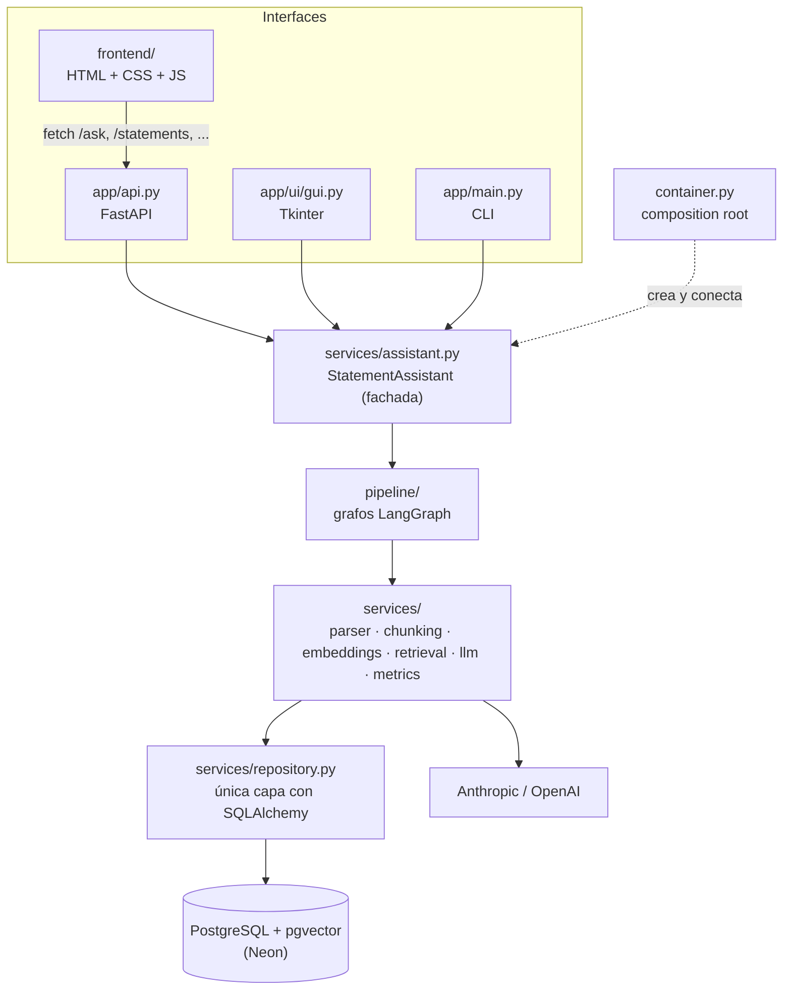
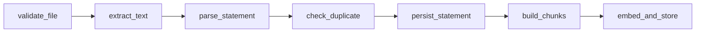
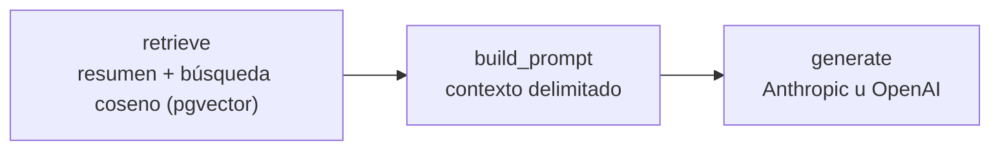
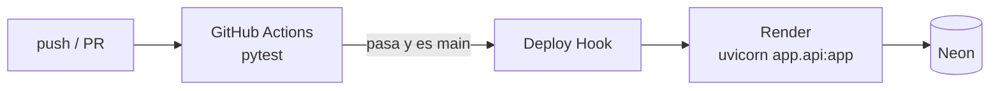

# Asistente de estado de cuenta (RAG + LangGraph)

Cargas el PDF del estado de cuenta de tu tarjeta (formato **Nu México**); la app extrae y guarda los datos en
**PostgreSQL + pgvector** y te deja hacerle preguntas a un LLM que responde usando como contexto lo recuperado de la
base de datos (**RAG**). Registra **logs, latencia, tokens, costo y errores** de cada llamada.

Se usa de tres formas, todas sobre el mismo código y la misma base de datos:

| Modo | Comando |
|---|---|
| Web (FastAPI + frontend) | `uvicorn app.api:app --reload` → http://127.0.0.1:8000 (Swagger en `/docs`) |
| Escritorio (Tkinter) | `python -m app.main` |
| Terminal | `python -m app.main --ingest estado.pdf` · `--ask "¿Cuánto debo pagar?"` · `--stats` |

En producción corre la versión web en **Render** (plan free) con la base de datos en **Neon** (plan free).

## Arquitectura

### Capas



- **Las interfaces no tienen lógica de negocio.** Las tres llaman a la misma fachada `StatementAssistant`; agregar
  otra (Streamlit, Gradio, un bot) no toca el resto.
- **`container.py` es el único lugar donde se crean dependencias.** Los servicios las reciben por constructor, lo que
  permite cambiar proveedores por configuración y probar con dobles (`tests/fakes.py`).
- **Los servicios no conocen LangGraph** y el repositorio es el único que conoce SQLAlchemy: cada capa se puede
  reemplazar o probar por separado.
- **El frontend está separado del backend** (`frontend/`), pero FastAPI lo sirve desde el mismo servicio: en
  producción es un solo deploy, sin CORS.

### Flujos (LangGraph)

**Ingesta** — un error o un PDF duplicado cortan el grafo:



**Preguntas:**



### Estructura de carpetas

```
├── app/
│   ├── main.py            # CLI + arranque de la GUI
│   ├── api.py             # FastAPI: endpoints REST + sirve frontend/
│   ├── container.py       # Composition root: crea y conecta todas las dependencias
│   ├── schemas.py         # Contratos pydantic (ParsedStatement, Chunk, LLMResponse, ...)
│   ├── core/
│   │   ├── config.py      # Settings + secretos (.env / variables de entorno, SecretStr)
│   │   ├── database.py    # Engine, sesiones, pgvector, verificación del esquema
│   │   ├── models.py      # ORM: statements, transactions, installments, document_chunks (vector), api_metrics
│   │   ├── logging.py     # Logs JSON (logs/app.jsonl) + request_id por operación
│   │   ├── prompts.py     # System prompt y armado del contexto
│   │   └── exceptions.py
│   ├── services/          # Lógica de negocio, sin LangGraph
│   │   ├── pdf_parser.py  # PdfTextExtractor + NuStatementParser (+ validaciones de consistencia)
│   │   ├── chunking.py    # ParsedStatement → fragmentos (resumen, escenarios, a meses, movimientos, análisis)
│   │   ├── embeddings.py  # Proveedores: local (sentence-transformers) | openai | fake
│   │   ├── retrieval.py   # Embedding de la pregunta + búsqueda pgvector (coseno) + resumen siempre
│   │   ├── llm.py         # Proveedores: anthropic | openai, con métricas
│   │   ├── metrics.py     # MetricsService + Stopwatch (latencia, tokens, costo)
│   │   ├── repository.py  # Única capa que conoce SQLAlchemy
│   │   └── assistant.py   # Fachada para API / GUI / CLI
│   ├── pipeline/          # LangGraph
│   │   ├── state.py       # IngestionState, QAState
│   │   ├── nodes.py       # IngestionNodes, QANodes (clases con dependencias inyectadas)
│   │   └── graph.py       # build_ingestion_graph, build_qa_graph
│   └── ui/gui.py          # Tkinter: cargar PDF, chat, resumen, métricas
├── frontend/              # Interfaz web (servida en / y /static)
│   ├── index.html         # Estructura
│   ├── css/styles.css     # Estilos
│   └── js/
│       ├── helpers.js     # Formato de fechas, moneda, escape de HTML
│       └── app.js         # Estado, llamadas a la API y renderizado
├── tests/                 # pytest, sin BD ni APIs (dobles en fakes.py)
├── .github/workflows/ci-cd.yml   # Tests en cada push; deploy a Render desde main
├── render.yaml            # Blueprint de Render (plan free)
├── requirements.txt       # Dependencias de la app (versiones fijas)
├── requirements-dev.txt   # + pytest
└── requirements-local-embeddings.txt  # Opcional: sentence-transformers (solo local)
```

### API web

| Método | Ruta | Qué hace |
|---|---|---|
| `GET` | `/` | Interfaz web (`frontend/index.html`) |
| `GET` | `/health` | Health check (lo usa Render) |
| `POST` | `/upload-pdf/` | Sube y procesa un PDF (grafo de ingesta) |
| `GET` | `/statements` | Lista los estados de cuenta cargados |
| `GET` | `/statements/{id}` | Detalle: resumen, movimientos, compras a meses |
| `GET` | `/statements/{id}/overview` | Resumen en texto |
| `DELETE` | `/statements/{id}` | Elimina un estado de cuenta |
| `POST` | `/ask` | Pregunta (grafo RAG) |
| `GET` | `/metrics` · `/metrics/recent` | Métricas agregadas y últimas llamadas |

## Puesta en marcha local

Requiere Python 3.12+ (Tkinter solo si usarás la GUI) y una base PostgreSQL con **pgvector**. Se recomienda
[Neon](https://neon.tech) (gratis, ya incluye pgvector).

```bash
python -m venv .venv && source .venv/bin/activate          # Windows: .venv\Scripts\activate
pip install -r requirements-dev.txt
pip install -r requirements-local-embeddings.txt            # solo si usarás EMBEDDING_PROVIDER=local
# crea .env con las variables de la tabla de abajo
python -m app.main --init-db                                # crea extensión y tablas
uvicorn app.api:app --reload                                # o: python -m app.main (GUI)
```

Ejecuta los comandos desde la carpeta raíz del proyecto (donde está este README).

### Variables de entorno (`.env`)

| Variable | Ejemplo / valores | Notas |
|---|---|---|
| `DB_HOST` | `ep-xxxx-pooler.….neon.tech` | |
| `DB_PORT` | `5432` | |
| `DB_NAME` | `ai_course` | |
| `DB_USER` | `<usuario>` | |
| `DB_PASSWORD` | `'<contraseña>'` | En `.env`, entre comillas simples si tiene `#` o `!`. **En Render, sin comillas.** |
| `DB_SCHEMA` | `<tu esquema>` | Debe existir; las tablas se crean dentro de él |
| `DB_SSLMODE` | `require` | Neon lo exige |
| `DATABASE_URL` | — | Opcional; si existe, **tiene prioridad** sobre las `DB_*` |
| `LLM_PROVIDER` | `anthropic` \| `openai` | |
| `ANTHROPIC_API_KEY` / `OPENAI_API_KEY` | — | La del proveedor elegido |
| `ANTHROPIC_MODEL` / `OPENAI_MODEL` | `claude-sonnet-5-5` / `gpt-4o-mini` | |
| `EMBEDDING_PROVIDER` | `local` \| `openai` \| `fake` | Ver sección *Embeddings* |
| `EMBEDDING_DIM` | `384` | `1536` con `text-embedding-3-small` |
| `REDACT_PII` | `true` | Oculta dirección, CLABE, RFC y nombre antes de enviar texto al LLM |
| `PRICE_INPUT_PER_MTOK` / `PRICE_OUTPUT_PER_MTOK` | `0` | USD por millón de tokens, para estimar costo |
| `APP_ENV` · `LOG_LEVEL` · `LOG_DIR` · `UPLOAD_DIR` | `dev` · `INFO` · `logs` · `archivos_subidos` | |

Si `--init-db` dice que pgvector no existe, ejecuta `CREATE EXTENSION vector;` en la consola SQL de Neon.

### Embeddings

Anthropic no ofrece API de embeddings, así que hay tres proveedores:

| Proveedor | Costo | Calidad | Dónde usarlo |
|---|---|---|---|
| `local` (sentence-transformers, 384 dim) | gratis | semántica | tu PC (necesita ~1 GB de RAM) |
| `fake` (hashing de palabras, 384 dim) | gratis | por palabras clave | Render free (512 MB) y tests |
| `openai` (`text-embedding-3-small`, 1536 dim) | de pago | semántica | si necesitas calidad en la nube |

Los vectores de distintos proveedores **no son comparables**: usa un `DB_SCHEMA` distinto por proveedor, o vuelve a
cargar los PDFs al cambiarlo. Cambiar de dimensión exige recrear la tabla `document_chunks`.

## Despliegue (Render + GitHub Actions, costo cero)



- **`.github/workflows/ci-cd.yml`**: en cada push y PR instala `requirements-dev.txt`, verifica que la app importa y
  corre `pytest`. Solo en push a `main` y con tests verdes, llama al Deploy Hook de Render.
- **`render.yaml`**: servicio web `free`, región `virginia` (cerca de Neon us-east-1), `autoDeploy: false` (el deploy
  lo decide CI), health check en `/health`, `EMBEDDING_PROVIDER=fake`.

**Configuración inicial (una vez):**

1. Render → **New → Blueprint** → elige el repo. Captura los valores marcados como `sync: false`
   (`DB_HOST`, `DB_NAME`, `DB_USER`, `DB_PASSWORD`, `DB_SCHEMA`, `ANTHROPIC_API_KEY`), sin comillas.
2. Render → servicio web → **Settings → Build & Deploy → Deploy Hook**: copia la URL
   (no confundir con el *Sync Hook* del Blueprint).
3. GitHub → **Settings → Secrets and variables → Actions** → secret `RENDER_DEPLOY_HOOK_URL` con esa URL.

**Limitaciones del plan free:** el servicio se duerme tras 15 min sin uso (la primera visita tarda ~30–60 s) y el
disco es efímero: los PDFs subidos se pierden al reiniciar, pero los datos procesados quedan en Neon.

## Secretos

- Todo se lee de `.env` o de variables de entorno (`app/core/config.py`); las claves son `SecretStr` y no se imprimen.
- `.env`, `.env.*`, los PDFs, `archivos_subidos/` y `logs/` están en `.gitignore`. **Nunca** los subas.
- En Render los secretos van en *Environment*; en GitHub, solo `RENDER_DEPLOY_HOOK_URL` como secret de Actions.
- Si una clave se expone (chat, captura, commit), revócala y genera otra.

## Observabilidad

| Qué | Dónde |
|---|---|
| Logs JSON con `request_id` | `logs/app.jsonl` (rotativo) y consola (en Render: pestaña *Logs*) |
| Métrica por llamada (`chat`, `embedding`, `retrieval`, `ingestion`): latencia, tokens, costo, estado, error | tabla `api_metrics` |
| Agregados: llamadas, errores, latencia promedio y p95, tokens, costo | pestaña **Métricas** / `GET /metrics` / `--stats` |
| Tiempo por nodo del grafo | `timings_ms` en `IngestResult` / `AskResult` y en logs (`node.<nombre>`) |

Consulta de ejemplo: `SELECT operation, avg(latency_ms), sum(input_tokens), sum(output_tokens) FROM api_metrics GROUP BY 1;`

## Decisiones de diseño

- **Parser determinista, no LLM:** las cifras se extraen con regex y se validan entre sí (el resumen debe cuadrar,
  compras parseadas = cargos regulares, etc.). Los avisos quedan en `Statement.extra.warnings`.
- **Los agregados se calculan en código** (`chunking._analytics`) y se escriben en el texto; el LLM no suma de memoria.
- **RAG:** cada estado de cuenta se divide en fragmentos autocontenidos con cabecera (periodo y tarjeta). El resumen
  siempre entra al contexto y el resto sale de una búsqueda por similitud coseno (índice HNSW).
- **Privacidad:** con `REDACT_PII=true` no se envía dirección, CLABE, RFC ni nombre completo al LLM ni al proveedor de
  embeddings. Los importes y comercios sí se envían: revisa las políticas de datos del proveedor.
- **Prompt injection:** el contexto va delimitado en `<contexto>` y el system prompt indica tratarlo como datos.
- **Idempotencia:** el hash SHA-256 del PDF evita cargarlo dos veces.
- **Arranque seguro:** si `DB_SCHEMA` no existe, la app falla indicando a qué base, usuario y host se conectó, en
  lugar de crear tablas en un lugar equivocado.
- **Versiones fijas** en `requirements*.txt`: CI, Render y tu PC instalan exactamente lo mismo.

## Pruebas

```bash
pip install -r requirements-dev.txt
pytest
```

`tests/test_parser.py` y `tests/test_chunking.py` usan un texto anonimizado (`tests/fixtures/nu_statement_sample.txt`).
`tests/test_pipeline.py` ejecuta ambos grafos completos con dobles (`tests/fakes.py`): sin PostgreSQL ni APIs.

## Limitaciones conocidas

- Solo soporta el formato de Nu México. Para otro banco, crea una subclase de `BaseStatementParser` y agrégala a `PARSERS`.
- PDFs escaneados (imagen) no funcionan: haría falta OCR.
- Las tarjetas adicionales / varias tarjetas en un mismo PDF no se distinguen.
- En Render free la búsqueda usa embeddings `fake` (por palabras clave), menos precisa que la semántica local.
