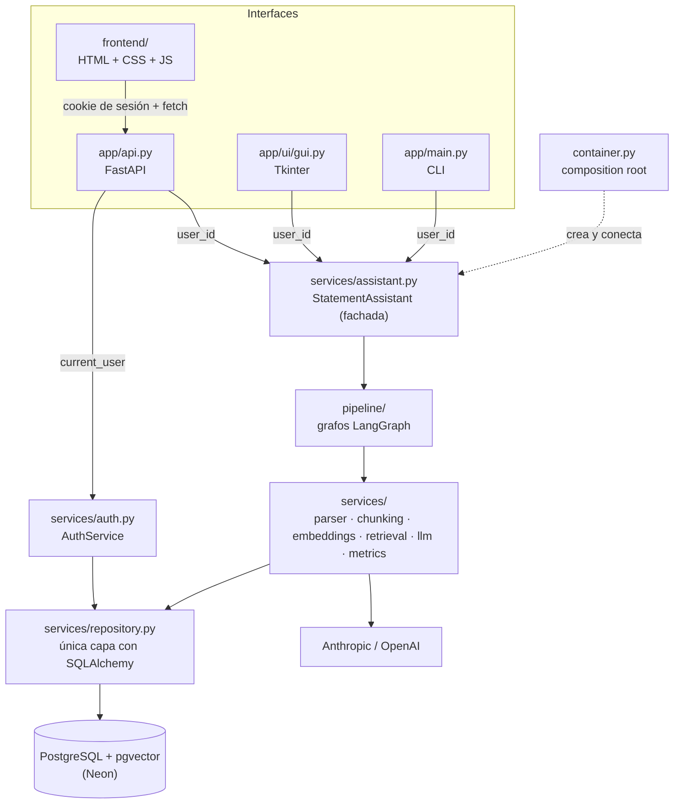
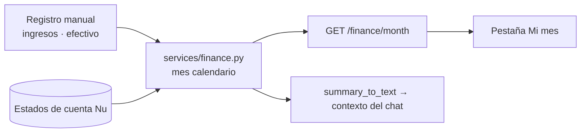
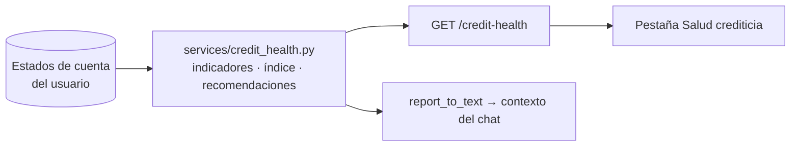
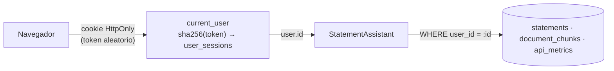
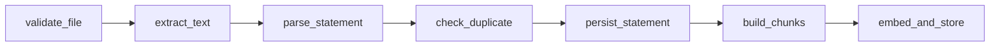
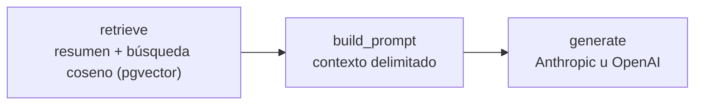
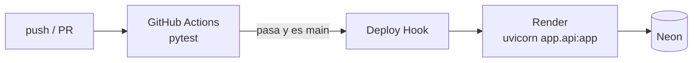

# Salud crediticia: asistente de estado de cuenta (RAG + LangGraph)

El objetivo de la app es **mostrar tu salud financiera**: la de tu tarjeta de crédito y la de tu mes completo.
Registras a mano tus **ingresos** y tus **gastos en efectivo**, cargas el PDF del estado de cuenta de tu tarjeta
(formato **Nu México**) y la app:

- arma tu **panorama del mes calendario**: cuánto ganaste, cuánto gastaste en efectivo y con Nu, cuánto te sobró y tu
  tasa de ahorro, con un **índice de salud financiera (0–100)**;

- calcula un **índice de salud crediticia (0–100)** con semáforos por indicador: uso del crédito, comportamiento de
  pago, puntualidad, costo del crédito, compromisos fijos y tendencia de la deuda;
- **clasifica tus compras** por categoría (salud, educación, hogar, entretenimiento…) y marca las que podrían ser
  deducibles;
- te da **recomendaciones con montos concretos** y te deja hacer preguntas a un LLM que responde con tus datos (**RAG**).

Los datos se guardan en **PostgreSQL + pgvector**. Registra **logs, latencia, tokens, costo y errores** de cada llamada.

Es **multiusuario**: cada persona crea su cuenta con usuario y contraseña desde la URL de la app (con un código de
invitación opcional) y solo ve sus propios estados de cuenta, preguntas y métricas.

Se usa de tres formas, todas sobre el mismo código y la misma base de datos:

| Modo | Comando |
|---|---|
| Web (FastAPI + frontend), multiusuario | `uvicorn app.api:app --reload` → http://127.0.0.1:8000 (Swagger en `/docs`) |
| Escritorio (Tkinter) | `python -m app.main` (opera como `LOCAL_USER`) |
| Terminal | `python -m app.main --ingest estado.pdf` · `--ask "¿Cuánto debo pagar?"` · `--stats` · `--user ana` |

En producción corre la versión web en **Render** (plan free) con la base de datos en **Neon** (plan free).

## Arquitectura

### Capas



- **Las interfaces no tienen lógica de negocio.** Las tres llaman a la misma fachada `StatementAssistant`; agregar
  otra (Streamlit, Gradio, un bot) no toca el resto.
- **`container.py` es el único lugar donde se crean dependencias.** Los servicios las reciben por constructor, lo que
  permite cambiar proveedores por configuración y probar con dobles (`tests/fakes.py`).
- **Los servicios no conocen LangGraph** y el repositorio es el único que conoce SQLAlchemy: cada capa se puede
  reemplazar o probar por separado.
- **El frontend está separado del backend** (`frontend/`), pero FastAPI lo sirve desde el mismo servicio: en
  producción es un solo deploy, sin CORS.

### Mi mes: ingresos, efectivo y tarjeta Nu



- **A mano** se registran solo **ingresos** (salario, honorarios u otros; "se repite cada mes" para el sueldo) y
  **gastos en efectivo** (la categoría se sugiere sola con las reglas de comercios; se puede cambiar).
- **Los gastos con Nu salen únicamente de los estados de cuenta**, ubicados por su fecha de operación: así nunca se
  cuentan dos veces.
- **Reglas de conteo:** los pagos a la tarjeta **no** son gasto (la compra ya se contó; se muestran como dato);
  intereses, comisiones e IVA **sí** (dinero perdido); las mensualidades a meses **no** se vuelven a sumar.
- Si parte del mes aún no está en un estado de cuenta cargado, la app dice exactamente qué días faltan.

**Índice de salud financiera** (mismas reglas que el crediticio: ponderado, solo con indicadores con datos, ≥40 de peso):

| Indicador | Cálculo | 🟢 / 🟡 / 🔴 | Peso |
|---|---|---|---|
| Tasa de ahorro | (ingresos − gastos) / ingresos | ≥20% / 10–20% / <10% | 25 |
| Gasto esencial | salud + educación + hogar + súper + transporte + servicios / ingresos | ≤50% / 50–70% / >70% | 15 |
| Saldo de tarjeta vs. ingreso | saldo Nu del último estado de cuenta / ingreso del mes | <30% / 30–60% / >60% | 15 |
| Costo del crédito vs. ingreso | intereses + comisiones + IVA / ingreso | 0 / <5% / ≥5% | 5 |
| Salud crediticia (Nu) | índice crediticio de la tarjeta (0–100, proporcional) | ≥80 / ≥60 / <60 | 40 |

Sin ingresos registrados, los cuatro primeros quedan "sin datos" y la app pide registrar el ingreso del mes.

### Salud crediticia



Todo se **calcula en código** a partir de los campos que extrae el parser; el LLM solo lo explica.

| Indicador | Cálculo | 🟢 / 🟡 / 🔴 | Peso |
|---|---|---|---|
| Uso del crédito | (límite − disponible) / límite | <30% / 30–50% / >50% | 30 |
| Comportamiento de pago | pagos del mes vs. "pago para no generar intereses" del mes anterior | total / más del mínimo / solo el mínimo o menos | 30 |
| Puntualidad | pagos hasta la fecha límite anterior ≥ pago mínimo | a tiempo / — / tarde o sin pago | 15 |
| Costo del crédito | intereses + comisiones + IVA (y últimos 12 meses) | $0 / hay costo / subió >5% | 10 |
| Compromisos fijos | mensualidades a meses / límite | <10% / 10–25% / >25% | 5 |
| Tendencia de la deuda | saldo vs. mes anterior | baja ≥5% / ±5% / sube ≥5% | 10 |
| Gasto contra pago | compras vs. pagos del periodo | informativo | 0 |

- **Índice** = promedio ponderado de los indicadores con datos (🟢 = 1, 🟡 = 0.5, 🔴 = 0). Con menos de 40 puntos de
  peso evaluables no se calcula (solo semáforos). Niveles: ≥80 Saludable · ≥60 Aceptable · ≥40 En riesgo · <40 Crítica.
  **Es orientativo: no es el score de Buró de Crédito**, y la app lo dice.
- Con **un solo mes** el comportamiento de pago se estima con el "adeudo del periodo anterior" del propio PDF;
  puntualidad y tendencia piden cargar el mes anterior (consecutivo).
- Los colores de gráficas y semáforos están validados (contraste ≥3:1, separación para daltonismo, modo claro y
  oscuro) y cada estado lleva además ícono y texto. Las gráficas tienen tooltip, foco con teclado y vista en tabla.

### Clasificación de gastos

Cascada en `services/categorizer.py` (nodo `categorize` del grafo de ingesta, después de descartar duplicados):

1. **Correcciones del usuario** (`merchant_categories`): si marcaste "Sears Metepec → Hogar", se respeta siempre.
2. **Reglas** por palabra clave para comercios comunes en México (gratis).
3. **Claude Haiku** con salida estructurada (`output_config` + JSON Schema con `enum`): una llamada por estado de
   cuenta, solo con los nombres de comercio pendientes, sin montos ni datos personales (~$0.0003 USD).
4. **Sin clasificar** si la confianza es menor a `CATEGORIZER_MIN_CONFIDENCE`: lo corriges con un clic en Movimientos y
   la corrección se aplica a todos los cargos de ese comercio y a los futuros.

Categorías: Salud · Educación · Hogar · Entretenimiento · Alimentos y restaurantes · Supermercado · Ropa y cuidado
personal · Transporte · Servicios y suscripciones · Otros. Salud y Educación se marcan como **posible deducible**
(solo con CFDI; la app no calcula impuestos). Si el LLM falla, la carga del PDF continúa.

### Multiusuario (tenant = usuario)



- **Aislamiento:** `statements`, `document_chunks` y `api_metrics` tienen `user_id`. Todo método del repositorio
  recibe `user_id` y lo pone en el `WHERE`; la búsqueda vectorial filtra por usuario. Un estado de cuenta de otra
  persona responde **404** (igual que uno inexistente), sin revelar que existe.
- **El `user_id` nunca viene del cliente:** la API lo toma de la sesión. La GUI y la CLI usan
  `assistant.for_user(id)`, con el usuario `LOCAL_USER`.
- **Duplicados por cuenta:** el mismo PDF puede cargarse en cuentas distintas (`UNIQUE(user_id, file_hash)`).
- **Contraseñas:** Argon2 (`pwdlib`). **Sesiones:** token aleatorio en cookie `HttpOnly; SameSite=Lax`
  (`Secure` en prod); en la BD solo se guarda su SHA-256. Duran `SESSION_TTL_HOURS` y se renuevan solas mientras
  se usen. Cambiar la contraseña cierra las demás sesiones.
- **Abuso:** límite de intentos de login por usuario e IP, mismo mensaje y tiempo exista o no el usuario, verificación
  de `Origin` en peticiones que modifican datos (CSRF), código de invitación y cuotas diarias por cuenta.
- **Roles:** `user` y `admin`. El admin puede ver las métricas de todas las cuentas (`?scope=all`).

### Flujos (LangGraph)

**Ingesta** — un error o un PDF duplicado cortan el grafo:



**Preguntas:**



### Estructura de carpetas

```
├── app/
│   ├── main.py            # CLI + arranque de la GUI + administración de cuentas
│   ├── api.py             # FastAPI: cuentas, endpoints REST protegidos + sirve frontend/
│   ├── migrate.py         # python -m app.migrate: aplica migraciones (Alembic)
│   ├── categorize_backfill.py # python -m app.categorize_backfill: clasifica compras ya cargadas
│   ├── container.py       # Composition root: crea y conecta todas las dependencias
│   ├── schemas.py         # Contratos pydantic (ParsedStatement, Chunk, LLMResponse, ...)
│   ├── core/
│   │   ├── config.py      # Settings + secretos (.env / variables de entorno, SecretStr)
│   │   ├── database.py    # Engine, sesiones, pgvector, verificación de esquema y revisión
│   │   ├── models.py      # ORM: users, user_sessions, statements, transactions, installments, document_chunks, api_metrics
│   │   ├── logging.py     # Logs JSON (logs/app.jsonl) + request_id por operación
│   │   ├── prompts.py     # System prompt y armado del contexto
│   │   └── exceptions.py
│   ├── services/          # Lógica de negocio, sin LangGraph
│   │   ├── pdf_parser.py  # PdfTextExtractor + NuStatementParser (+ validaciones de consistencia)
│   │   ├── chunking.py    # ParsedStatement → fragmentos (resumen, escenarios, a meses, movimientos, análisis)
│   │   ├── embeddings.py  # Proveedores: local (sentence-transformers) | openai | fake
│   │   ├── retrieval.py   # Embedding de la pregunta + búsqueda pgvector (coseno) + resumen siempre
│   │   ├── llm.py         # Proveedores: anthropic | openai, con métricas
│   │   ├── metrics.py     # MetricsService + Stopwatch (latencia, tokens, costo)
│   │   ├── repository.py  # Única capa que conoce SQLAlchemy (siempre filtra por user_id)
│   │   ├── auth.py        # AuthService: registro, login, sesiones, límite de intentos
│   │   ├── categorizer.py # Categorías de gasto: correcciones → reglas → Haiku → sin clasificar
│   │   ├── credit_health.py # Indicadores, índice 0-100 y recomendaciones (en código)
│   │   ├── finance.py     # Mes calendario: ingresos + efectivo + Nu; índice de salud financiera
│   │   └── assistant.py   # Fachada para API / GUI / CLI + cuotas de uso
│   ├── pipeline/          # LangGraph
│   │   ├── state.py       # IngestionState, QAState
│   │   ├── nodes.py       # IngestionNodes, QANodes (clases con dependencias inyectadas)
│   │   └── graph.py       # build_ingestion_graph, build_qa_graph
│   └── ui/gui.py          # Tkinter: cargar PDF, chat, resumen, métricas
├── frontend/              # Interfaz web (servida en / y /static)
│   ├── index.html         # Estructura
│   ├── css/styles.css     # Estilos
│   └── js/
│       ├── helpers.js     # Formato de fechas, moneda, escape de HTML
│       ├── app.js         # Estado, llamadas a la API y renderizado
│       ├── health.js      # Pestaña Salud crediticia: índice, semáforos y gráficas SVG
│       ├── finance.js     # Pestaña Mi mes: registro rápido, panorama y movimientos del mes
│       └── auth.js        # Entrar / crear cuenta / salir / cambiar contraseña; arranque
├── migrations/            # Alembic: 0001 base, 0002 multiusuario, 0003 categorías, 0004 ingresos y efectivo
├── alembic.ini
├── tests/                 # pytest: dobles en fakes.py; test_db.py usa PostgreSQL real
├── .github/workflows/ci-cd.yml   # Tests en cada push; deploy a Render desde main
├── render.yaml            # Blueprint de Render (plan free)
├── requirements.txt       # Dependencias de la app (versiones fijas)
├── requirements-dev.txt   # + pytest
└── requirements-local-embeddings.txt  # Opcional: sentence-transformers (solo local)
```

### API web

Todas las rutas de datos requieren sesión (si no, **401**) y operan solo sobre la cuenta en sesión.

| Método | Ruta | Qué hace |
|---|---|---|
| `GET` | `/` | Interfaz web (`frontend/index.html`) — pública |
| `GET` | `/health` | Health check (lo usa Render) — pública |
| `GET` | `/auth/config` | ¿El registro pide código de invitación? — pública |
| `POST` | `/auth/register` | Crea la cuenta e inicia sesión — pública |
| `POST` | `/auth/login` · `/auth/logout` | Inicia / cierra sesión |
| `GET` | `/auth/me` | Usuario en sesión |
| `POST` | `/auth/password` | Cambia la contraseña (cierra las demás sesiones) |
| `POST` | `/upload-pdf/` | Sube y procesa un PDF (grafo de ingesta); **429** si se excede la cuota |
| `GET` | `/statements` | Lista los estados de cuenta cargados |
| `GET` | `/statements/{id}` | Detalle: resumen, movimientos, compras a meses |
| `GET` | `/statements/{id}/overview` | Resumen en texto |
| `DELETE` | `/statements/{id}` | Elimina un estado de cuenta |
| `GET` | `/credit-health?statement_id=` | Índice, indicadores, recomendaciones, categorías y series mensuales |
| `GET` | `/categories` | Catálogo de categorías de gasto |
| `GET` | `/finance/month?month=AAAA-MM` | Panorama del mes: ingresos, efectivo, Nu, índice, categorías y movimientos |
| `POST` · `PATCH` · `DELETE` | `/incomes`, `/incomes/{id}` | Ingresos (únicos o recurrentes; `end_date` deja de repetirlo) |
| `POST` · `PATCH` · `DELETE` | `/cash-expenses`, `/cash-expenses/{id}` | Gastos en efectivo |
| `PATCH` | `/transactions/{id}/category` | Corrige la categoría (y la de todos los cargos de ese comercio) |
| `POST` | `/ask` | Pregunta (grafo RAG + salud crediticia); **429** si se excede la cuota |
| `GET` | `/metrics` · `/metrics/recent` | Métricas propias; `?scope=all` (solo admin) de todas las cuentas |

## Puesta en marcha local

Requiere Python 3.12+ (Tkinter solo si usarás la GUI) y una base PostgreSQL con **pgvector**. Se recomienda
[Neon](https://neon.tech) (gratis, ya incluye pgvector).

```bash
python -m venv .venv && source .venv/bin/activate          # Windows: .venv\Scripts\activate
pip install -r requirements-dev.txt
pip install -r requirements-local-embeddings.txt            # solo si usarás EMBEDDING_PROVIDER=local
# crea .env con las variables de la tabla de abajo
python -m app.migrate                                       # crea / actualiza las tablas (Alembic)
python -m app.main --create-user tu_usuario --admin         # opcional: tu cuenta de admin
uvicorn app.api:app --reload                                # o: python -m app.main (GUI)
```

Ejecuta los comandos desde la carpeta raíz del proyecto (donde está este README).

### Variables de entorno (`.env`)

| Variable | Ejemplo / valores | Notas |
|---|---|---|
| `DB_HOST` | `ep-xxxx-pooler.….neon.tech` | |
| `DB_PORT` | `5432` | |
| `DB_NAME` | `ai_course` | |
| `DB_USER` | `<usuario>` | |
| `DB_PASSWORD` | `'<contraseña>'` | En `.env`, entre comillas simples si tiene `#` o `!`. **En Render, sin comillas.** |
| `DB_SCHEMA` | `<tu esquema>` | Debe existir; las tablas se crean dentro de él |
| `DB_SSLMODE` | `require` | Neon lo exige |
| `DATABASE_URL` | — | Opcional; si existe, **tiene prioridad** sobre las `DB_*` |
| `LLM_PROVIDER` | `anthropic` \| `openai` | |
| `ANTHROPIC_API_KEY` / `OPENAI_API_KEY` | — | La del proveedor elegido |
| `ANTHROPIC_MODEL` / `OPENAI_MODEL` | `claude-sonnet-5-5` / `gpt-4o-mini` | |
| `EMBEDDING_PROVIDER` | `local` \| `openai` \| `fake` | Ver sección *Embeddings* |
| `EMBEDDING_DIM` | `384` | `1536` con `text-embedding-3-small` |
| `REDACT_PII` | `true` | Oculta dirección, CLABE, RFC y nombre antes de enviar texto al LLM |
| `PRICE_INPUT_PER_MTOK` / `PRICE_OUTPUT_PER_MTOK` | `0` | USD por millón de tokens, para estimar costo |
| `APP_ENV` · `LOG_LEVEL` · `LOG_DIR` · `UPLOAD_DIR` | `dev` · `INFO` · `logs` · `archivos_subidos` | Con `prod`: cookies `Secure` y sin `/docs` |
| `SIGNUP_INVITE_CODE` | `<código>` | Si está definido, el registro lo exige. **Recomendado** al compartir la URL |
| `SESSION_TTL_HOURS` | `168` | Duración de la sesión (se renueva con el uso) |
| `MAX_USERS` · `MAX_STATEMENTS_PER_USER` | `50` · `24` | `0` = sin límite |
| `MAX_ASKS_PER_DAY` · `MAX_UPLOADS_PER_DAY` | `30` · `10` | Por cuenta, día UTC. `0` = sin límite |
| `MAX_MANUAL_ENTRIES_PER_DAY` | `200` | Ingresos + gastos en efectivo registrados en 24 h |
| `LOGIN_MAX_ATTEMPTS` · `LOGIN_WINDOW_MINUTES` | `5` · `15` | Intentos fallidos antes de bloquear |
| `LOCAL_USER` | `local` | Usuario con el que operan la GUI y la CLI |
| `CATEGORIZER_LLM` · `CATEGORIZER_MODEL` | `true` · `claude-haiku-5-5` | Clasificación con LLM (requiere `ANTHROPIC_API_KEY`) |
| `CATEGORIZER_MIN_CONFIDENCE` | `0.6` | Debajo de esto el comercio queda "sin clasificar" |
| `CATEGORIZER_PRICE_INPUT_PER_MTOK` · `..._OUTPUT_...` | `0.10` · `0.50` | Para registrar el costo de la clasificación |
| `ADMIN_USERNAME` · `ADMIN_PASSWORD` | `admin` · — | Dueño de los datos previos a la migración multiusuario (solo se usan en ella) |
| `COOKIE_SECURE` · `EXPOSE_DOCS` | — | Para forzar el comportamiento de cookies / `/docs` sin depender de `APP_ENV` |

### Cuentas desde la terminal

```bash
python -m app.main --create-user ana [--admin]   # pide la contraseña sin mostrarla
python -m app.main --reset-password ana          # "olvidé mi contraseña": la cambia y cierra sus sesiones
python -m app.main --set-role ana admin
python -m app.main --user ana --ask "¿Cuánto debo pagar?"
```

No hay recuperación de contraseña por correo: el admin la restablece con `--reset-password`.

Si `--init-db` dice que pgvector no existe, ejecuta `CREATE EXTENSION vector;` en la consola SQL de Neon.

### Embeddings

Anthropic no ofrece API de embeddings, así que hay tres proveedores:

| Proveedor | Costo | Calidad | Dónde usarlo |
|---|---|---|---|
| `local` (sentence-transformers, 384 dim) | gratis | semántica | tu PC (necesita ~1 GB de RAM) |
| `fake` (hashing de palabras, 384 dim) | gratis | por palabras clave | Render free (512 MB) y tests |
| `openai` (`text-embedding-3-small`, 1536 dim) | de pago | semántica | si necesitas calidad en la nube |

Los vectores de distintos proveedores **no son comparables**: usa un `DB_SCHEMA` distinto por proveedor, o vuelve a
cargar los PDFs al cambiarlo. Cambiar de dimensión exige recrear la tabla `document_chunks`.

## Despliegue (Render + GitHub Actions, costo cero)



- **`.github/workflows/ci-cd.yml`**: en cada push y PR instala `requirements-dev.txt`, verifica que la app importa y
  corre `pytest`. Solo en push a `main` y con tests verdes, llama al Deploy Hook de Render.
- **`render.yaml`**: servicio web `free`, región `virginia` (cerca de Neon us-east-1), `autoDeploy: false` (el deploy
  lo decide CI), health check en `/health`, `EMBEDDING_PROVIDER=fake`. Al arrancar ejecuta `python -m app.migrate`
  (el plan free no tiene *pre-deploy command*), `python -m app.categorize_backfill` (idempotente: clasifica compras
  que aún no tengan categoría) y luego uvicorn con `--proxy-headers` para conocer la IP real.
- **CI** tiene dos jobs de pruebas: con dobles (`test`) y con PostgreSQL + pgvector real como *service container*
  (`test-db`: migraciones y filtros por usuario en SQL). El deploy espera a ambos.

**Configuración inicial (una vez):**

1. Render → **New → Blueprint** → elige el repo. Captura los valores marcados como `sync: false`
   (`DB_HOST`, `DB_NAME`, `DB_USER`, `DB_PASSWORD`, `DB_SCHEMA`, `ANTHROPIC_API_KEY`, `SIGNUP_INVITE_CODE`,
   `ADMIN_USERNAME`, `ADMIN_PASSWORD`), sin comillas.
2. Render → servicio web → **Settings → Build & Deploy → Deploy Hook**: copia la URL
   (no confundir con el *Sync Hook* del Blueprint).
3. GitHub → **Settings → Secrets and variables → Actions** → secret `RENDER_DEPLOY_HOOK_URL` con esa URL.

**Migración a multiusuario de una BD que ya tiene datos (una sola vez):**

1. Respáldala: en Neon crea una *branch* de la base (gratis) antes del primer deploy multiusuario.
2. Define `ADMIN_USERNAME` y `ADMIN_PASSWORD` (en Render o en tu `.env`): esa cuenta admin queda como dueña de los
   estados de cuenta y métricas existentes.
3. Despliega (o corre `python -m app.migrate` localmente). La migración detecta las tablas previas a Alembic, las marca
   como `0001_baseline` y aplica `0002_multitenant`.
4. Entra con esa cuenta. Si no definiste `ADMIN_PASSWORD`, ponle una con `python -m app.main --reset-password <usuario>`.
5. Comparte la URL y el `SIGNUP_INVITE_CODE`. Pon también un tope de gasto mensual en la consola de Anthropic.

**Limitaciones del plan free:** el servicio se duerme tras 15 min sin uso (la primera visita tarda ~30–60 s) y el
disco es efímero: los PDFs subidos se pierden al reiniciar, pero los datos procesados quedan en Neon.

## Secretos

- Todo se lee de `.env` o de variables de entorno (`app/core/config.py`); las claves son `SecretStr` y no se imprimen.
- `.env`, `.env.*`, los PDFs, `archivos_subidos/` y `logs/` están en `.gitignore`. **Nunca** los subas.
- En Render los secretos van en *Environment*; en GitHub, solo `RENDER_DEPLOY_HOOK_URL` como secret de Actions.
- Si una clave se expone (chat, captura, commit), revócala y genera otra.
- Las contraseñas de las cuentas nunca se guardan ni se registran en logs; solo su hash Argon2.

## Observabilidad

| Qué | Dónde |
|---|---|
| Logs JSON con `request_id` | `logs/app.jsonl` (rotativo) y consola (en Render: pestaña *Logs*) |
| Métrica por llamada (`chat`, `embedding`, `retrieval`, `ingestion`): latencia, tokens, costo, estado, error | tabla `api_metrics` |
| Agregados: llamadas, errores, latencia promedio y p95, tokens, costo | pestaña **Métricas** / `GET /metrics` / `--stats` |
| Tiempo por nodo del grafo | `timings_ms` en `IngestResult` / `AskResult` y en logs (`node.<nombre>`) |

Consulta de ejemplo: `SELECT operation, avg(latency_ms), sum(input_tokens), sum(output_tokens) FROM api_metrics GROUP BY 1;`

## Decisiones de diseño

- **Parser determinista, no LLM:** las cifras se extraen con regex y se validan entre sí (el resumen debe cuadrar,
  compras parseadas = cargos regulares, etc.). Los avisos quedan en `Statement.extra.warnings`.
- **Los agregados se calculan en código** (`chunking._analytics`) y se escriben en el texto; el LLM no suma de memoria.
- **RAG:** cada estado de cuenta se divide en fragmentos autocontenidos con cabecera (periodo y tarjeta). El resumen
  siempre entra al contexto y el resto sale de una búsqueda por similitud coseno (índice HNSW).
- **Privacidad:** con `REDACT_PII=true` no se envía dirección, CLABE, RFC ni nombre completo al LLM ni al proveedor de
  embeddings. Los importes y comercios sí se envían: revisa las políticas de datos del proveedor.
- **Prompt injection:** el contexto va delimitado en `<contexto>` y el system prompt indica tratarlo como datos.
- **Idempotencia:** el hash SHA-256 del PDF evita cargarlo dos veces.
- **Arranque seguro:** si `DB_SCHEMA` no existe, la app falla indicando a qué base, usuario y host se conectó, en
  lugar de crear tablas en un lugar equivocado.
- **Versiones fijas** en `requirements*.txt`: CI, Render y tu PC instalan exactamente lo mismo.
- **Migraciones con Alembic** (no `create_all`): la app verifica al arrancar que la BD esté en la última revisión y,
  si no, pide ejecutar `python -m app.migrate`.
- **Sesiones en BD en lugar de JWT:** se pueden revocar (logout real, cambio de contraseña) y no requieren secretos
  extra que rotar.

## Pruebas

```bash
pip install -r requirements-dev.txt
pytest
```

`tests/test_parser.py` y `tests/test_chunking.py` usan un texto anonimizado (`tests/fixtures/nu_statement_sample.txt`).
`tests/test_pipeline.py` ejecuta ambos grafos completos con dobles (`tests/fakes.py`): sin PostgreSQL ni APIs.
`tests/test_auth.py` cubre registro, contraseñas, sesiones (con reloj simulado) y límite de intentos.
`tests/test_categorizer.py` cubre reglas, la cascada (correcciones → reglas → LLM), confianza baja y fallas del LLM.
`tests/test_credit_health.py` cubre cada indicador, el índice y los casos de un mes, pago mínimo, pago tardío y meses
no consecutivos.
`tests/test_finance.py` cubre ingresos recurrentes, huecos de cobertura de Nu, las reglas de conteo (pagos y
mensualidades no son gasto), el índice y las validaciones; `tests/test_frontend.py` revisa que los scripts del
frontend no choquen entre sí.
`tests/test_api.py` levanta la API con dos cuentas y verifica aislamiento (404 cruzados), cuotas (429), CSRF y sesiones.
`tests/test_db.py` corre las migraciones y los filtros por usuario contra PostgreSQL real:

```bash
RUN_DB_TESTS=1 DB_SCHEMA=<esquema vacío> pytest tests/test_db.py   # se niega a correr si el esquema tiene datos
```

## Limitaciones conocidas

- Solo soporta el formato de Nu México. Para otro banco, crea una subclase de `BaseStatementParser` y agrégala a `PARSERS`.
- PDFs escaneados (imagen) no funcionan: haría falta OCR.
- Las tarjetas adicionales / varias tarjetas en un mismo PDF no se distinguen.
- En Render free la búsqueda usa embeddings `fake` (por palabras clave), menos precisa que la semántica local.
- El límite de intentos de login vive en memoria: se reinicia con el servicio y supone una sola instancia.
- Sin recuperación de contraseña por correo ni borrado de cuenta en la interfaz (los hace el admin desde la terminal).
- Los nombres de comercio en el PDF a veces vienen abreviados ("Vsfa Galerias Metepec"): esos quedan sin clasificar
  hasta que el usuario los corrige.
- La GUI de escritorio (Tkinter) todavía no muestra la salud crediticia, las categorías ni "Mi mes"; están en la web
  y en el chat.
- A mano solo se registran efectivo e ingresos: las compras con Nu del mes en curso aparecen hasta cargar el estado de
  cuenta que las incluye.
